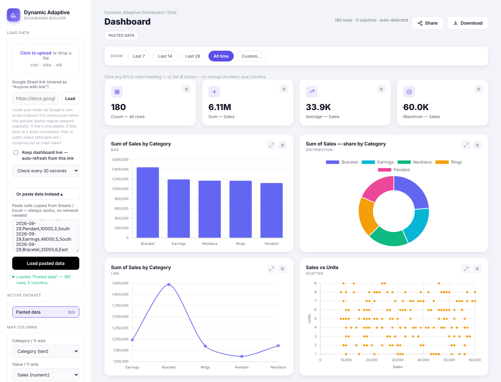

# DYNAMIC-ADAPTIVE-DASHBOARD

I am thrilled to share that I have successfully built a **Dynamic Adaptive Dashboard** builder! 🎉 Upload any CSV or Excel file, load a Google Sheet, or paste your cells, and the dashboard builds itself from your columns: KPIs, charts and a searchable data table. It is a single HTML file with no backend and no installation.

*Preview shown with sample sales data.*

## 🔍 Key Features Include:

- Auto-detects column types (text, numeric, date) and builds the dashboard automatically
- KPI cards: row count, sum, average and maximum, each fully configurable
- Load data from a **CSV, XLSX or XLS file** (click or drag and drop)
- Load a **Google Sheet link** shared as "Anyone with link"
- **Paste data** directly from Google Sheets or Excel, which works with no network
- **Live mode:** auto-refresh from the Google Sheet link every 15 seconds, 30 seconds, 1 minute or 5 minutes, with a LIVE badge
- Work with multiple datasets and switch the active one

## 📊 Detailed Visualizations:

- Bar chart: totals by category
- Doughnut chart: share of total
- Line chart: trend across records
- Scatter plot: correlation between two numeric columns
- Raw data table with row filter and column sorting
- Click any chart to expand it and see the full data behind it

## 🎛️ Dynamic Controls:

- **Map columns:** choose the category / X-axis, value / Y-axis and a secondary numeric column
- **Aggregations:** sum, average, count, count unique, minimum, maximum and median
- **Date filters:** Last 7, Last 14, Last 28, All time or a custom range from a calendar
- **Per-widget settings:** click any KPI or chart heading, or its ⚙ button, to change its metric and columns, with a reset-to-default option
- **Share:** copy a link to the dashboard tool (your data stays in your browser)
- **Download:** all charts as PNG, raw data as CSV, or raw data as Excel
- Responsive layout for desktop, tablet and phone

## 🛠️ Tech Stack

- HTML, CSS and vanilla JavaScript in a single `index.html`
- [Chart.js](https://www.chartjs.org/) for charts, [PapaParse](https://www.papaparse.com/) for CSV and [SheetJS](https://sheetjs.com/) for Excel files, loaded from a CDN

## 🚀 How to Use

1. Open `index.html` in a browser with an internet connection, or host it on GitHub Pages.
2. Upload a file, paste a Google Sheet link, or paste your data.
3. Pick your columns and aggregation in the **Map columns** panel.
4. Click any chart or KPI to fine-tune it, then share or download the results.

For a live Google Sheet, share the sheet as "Anyone with link", paste the link, and turn on **Keep dashboard live**.

## 📄 Related Files

- `Summary_organized.pdf`: project summary of the earlier Sohlene Stock Ledger version of this dashboard

This dashboard lets anyone turn a raw spreadsheet into a clear, interactive report in seconds, ensuring a better experience for everyone.
